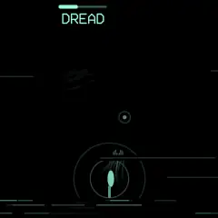
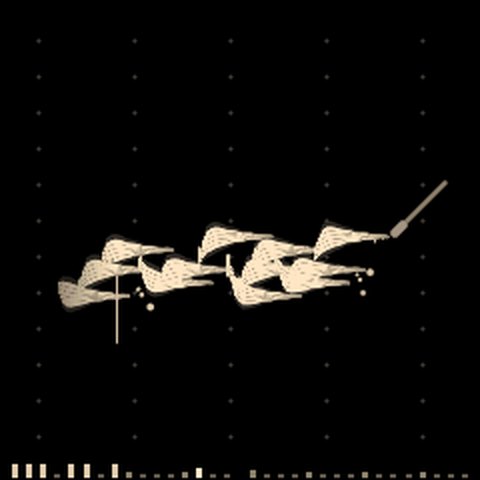

# h1 (or handy-1)

Custom firmware for the M-VAVE FM-1. Sixteen instruments with dynamic visuals. Eight algorithms 
and four live knobs, plus a loop recorder, a step sequencer, an arpeggiator and a metronome. 
Works on both the original flash chip and the newer UC25HQ80. Uses fm1-base.

**USB audio and MIDI.** Over one USB cable the FM-1 is an audio input and a MIDI device, so you can
record h1 straight into a computer or a phone. MIDI in works over USB and the TRS jack: notes play
at their velocity, and CC 20 to 23 turn the four knobs. MIDI out is USB only, on channel 1: the
FM-1's TRS jack is an input. See [USB audio and MIDI](#usb-audio-and-midi).

[](https://thefirmwarehub.com/firmware/h1/)

The easiest way to install h1 is [its listing on The Firmware Hub](https://thefirmwarehub.com/firmware/h1/):
connect the FM-1 over USB in Chrome or Edge and press **Install**. [Install](#install) below has
the details and the manual `.fwsc` route.

<p>
    
    
    

</p>

**The full guide is at [jakehandy.com/h1](https://jakehandy.com/h1).** It covers every instrument's
knobs and algorithms, the settings pages, loop and step recording, and FAQs.

| | Sound | Knobs |
|---|---|---|
| **COZY** | lo-fi keys | DUST, WOW, MUFFLE, SWAY |
| **ORBIT** | space synths | SWEEP, SPIN, SHIMMER, GRAVITY |
| **KOI** | struck metal and wood: handpan, kalimba, marimba | MALLET, RIPPLE, LINGER, SINK |
| **HAUNT** | spooky ambient | FOG, DREAD, SHIVER, DEPTH |
| **TIDE** | analog pad | GLOW, HALO, DRIFT, SURGE |
| **PIP** | chiptune | SHAPE, WOBBLE, ZAP, CRUNCH |
| **BONK** | drum kit, a drum on every note of the octave | TUNE, DECAY, PUNCH, DIRT |
| **URCHIN** | FM | RATIO, DEPTH, FUZZ, TAIL |
| **TWANG** | plucked strings, from recordings of real ones: harp, guitars, sitar, banjo, koto, bass, and a bowed cello | DAMP, PICK, TONE, BUZZ |
| **LAVA** | wavefolder bass | FOLD, HEAT, LEAN, SUB |
| **KNOT** | additive bells | BLOOM, RING, TWIST, WARP |
| **INK** | gliding lead | SLIDE, SHAKE, PRESS, DRY |
| **BARD** | medieval, from recordings of real instruments: lute, harp, psaltery, gurdy, rebec, shawm, bagpipe, organ, over a drone | DRONE, COURSE, BITE, AGE |
| **TURBO** | eighties synths, a little tape-warped | CHORUS, TAPE, GLARE, DRIVE |
| **TILT** | electronic drum kits, 8-bit first, on a pinball table that is a drum kit: the kick is the flippers, the snare and toms are the bumpers, the crash fires the plunger | TUNE, DECAY, BOUNCE, BITS |
| **PLUNK** | drum kits of recorded hits: gong, bells, darbuka, congas, timpani, anvil; a steel tongue drum in the grass of a garden in the rain, by a stone lantern | TUNE, DECAY, WIND, STORM |

<p>
  
</p>

## Try it in the browser

Open [the simulator](https://jakehandy.com/public/h1/simulator.html). It lives in its own repo,
[fm1-browser-simulator](https://github.com/jakehandy/fm1-browser-simulator), opens on h1, runs the
same C code that goes on the device, and can play other FM-1 firmwares too.

## Install

> **h1 is new.** Its releases have been installed and played on one FM-1, a unit bought in
> November 2026: v0.1.0 from the stock firmware, each later one over the one before. A tester put
> v0.2.1 on a unit with the older flash chip, over stock V16
> ([#25](https://github.com/jakehandy/h1/issues/25)). Going back to stock through the Hub's
> **Back to official V15** and installing h1 from another custom firmware have not been tried yet:
> [docs/RELEASE-CHECKLIST.md](docs/RELEASE-CHECKLIST.md) says what has.

### Before you install

- **Back up first.** Every firmware keeps your work in the FM-1's flash in its own way. Presets,
  projects and samples saved by the firmware you are leaving may be gone or unreadable afterwards,
  and going back doesn't always bring them back. Save them with that firmware's own backup. The
  Firmware Hub's notes on this are [here](https://thefirmwarehub.com/kb/#data).
- Charge the FM-1, and use a USB cable that carries data.
- h1 is community firmware with no warranty. You install it at your own risk. It has nothing to
  do with M-VAVE.

### From the stock firmware (V15)

If the FM-1 runs something older than V15, update it to V15 with M-VAVE's updater first.

1. Connect the FM-1 over USB to a computer running Chrome or Edge.
2. Open [h1 on The Firmware Hub](https://thefirmwarehub.com/firmware/h1/), press **Connect FM-1** and allow
   MIDI.
3. Press **Install** on h1. It takes about a minute. Keep the cable in until the FM-1 restarts
   into h1.

### From another custom firmware

The same three steps. The firmware you are running starts h1's update loader, and the loader
writes h1. If the Hub says the FM-1 is still in another firmware's update mode, finish that update
with that firmware's installer first.

### From a terminal

Download `h1-X.Y.Z.fwsc` from [Releases](https://github.com/jakehandy/h1/releases), then from a
clone of this repo (`git clone --recurse-submodules`):

```
pip3 install mido python-rtmidi
python3 base/tools/fm1_install.py h1-X.Y.Z.fwsc
```

It works from V15 and from other firmwares, asks before it writes, and checks what the FM-1
answers afterwards.

## Leave h1 again

h1's package carries an update loader, so the same installers can replace it.

- **Another custom firmware:** press **Install** on its card at
  [The Firmware Hub](https://thefirmwarehub.com), or use that firmware's own installer.
- **Back to stock:** press **Back to official V15** in the Hub's
  [Official firmware](https://thefirmwarehub.com/#official) box.

h1 only saves its own settings. Leaving it doesn't restore what an earlier firmware had saved.
That is what the backup is for.

## If something goes wrong

- **An install stopped halfway:** plug the FM-1 back in and press Install again. The loader picks
  up where it stopped.
- **h1 doesn't start:** after two failed starts it comes up in SAFE MODE. There is no sound, but
  USB works, so the Hub can install h1 again, another firmware, or V15.
- **Nothing reaches it:** hold **REC** while you switch it on. That is the chip's own update mode,
  and the Hub's [rescue page](https://thefirmwarehub.com/tools/rescue/) takes it from there. The
  chip's bootloader is in ROM and can't be overwritten.

## Compatibility

- **M-VAVE FM-1 only.** Not the SMK-37.
- **Both flash chips.** h1 saves and updates on the original Puya P25Q80 (JEDEC ID `0x856014`)
  and on the UC25HQ80 (`0xB36014`) fitted to units sold since autumn 2026.
- USB audio out (the mix and four stems) and USB MIDI in and out, or USB host for a keyboard. MIDI in over the TRS jack too. No MIDI out over TRS, and
  no Bluetooth. See [USB audio and MIDI](#usb-audio-and-midi).
- A screen reader ([fm1-reader](https://github.com/charlesvestal/fm1-reader)) hears the
  instrument, the algorithm, the page and each control's value as it changes. It can't describe
  the pictures.
- Package identity `FM-1_481`. A release X.Y.Z answers `FM-1_481XXYYZZ`.

## USB audio and MIDI

Plug the FM-1 into a computer or a phone with a USB cable that carries data. It shows up as one
device with two parts.

**Audio.** An audio input, like a USB microphone, with ten channels at 44.1 kHz. Pick the FM-1 as the
input in a DAW, a recording app or the system's sound settings, and record. Nothing plays back through
it: the FM-1 isn't a sound card for the computer.

| Channels | What's on them |
|---|---|
| 1-2 | The whole mix at the MASTER volume, the same as the speaker |
| 3-4 | Stem 1: the instrument of the first layer in the layer view |
| 5-6 | Stem 2: the instrument of the next layer on another instrument |
| 7-8 | Stem 3: the next one again |
| 9-10 | Stem 4: everything else |

Each stem is an instrument at its own volume and MASTER, dry: ECHO, SPACE, TONE, the metronome and
the cue voice are only on 1-2, because they run over the whole mix. With fewer than three instruments
on the loop's layers, the instrument in hand takes the next free stem, so without LAYERS what you
play is on 3-4. Two layers on the same instrument share its stem. A layer keeps its stem while muted, so a take
in a DAW keeps its tracks; a layer with no notes left takes none. A recording app that wants stereo
takes channels 1 and 2. To split a ten-channel file into five stereo ones, run
`python3 tools/h1_stems.py REC.wav --split OUTDIR`.

**MIDI in,** over USB or the TRS jack, on any channel (or the one CHAN on the MIDI page picks):

- Notes play the instrument in hand at their velocity, about 20 dB from the softest to the hardest,
  and darker the softer they are. The FM-1's own keys play at full.
- CC 20 to 23 turn the four knobs. CC 123 stops every note.
- Off until you turn them on, on the MIDI page: pitch bend (BEND, 2 or 12 semitones), the mod wheel
  (WHEEL, deeper live modulation) and a sustain pedal (PEDAL, CC 64).
- The loop and the step sequencer record the velocity and play it back.

**MIDI out,** over USB only, on channel 1 (or CHAN's):

- The notes of the keys, the arpeggiator and the sequencer, so a DAW can record what you play as
  MIDI, or h1 can play another synth.
- CC 20 to 23 as the four knobs turn.
- A note that came in over MIDI isn't sent back out, so a DAW that echoes its input doesn't loop.

**The loop as a MIDI file.** Send h1 the SysEx message `F0 7D 68 31 4C F7` over USB-MIDI and it sends
the loop back as SysEx (the screen says `SENDING LOOP`, then `LOOP SENT`). Save what comes back to a
`.syx` file and run `python3 tools/h1_loop_mid.py loop.syx loop.mid`: one track a layer, at the loop's
tempo and meter. If the loop changes while it goes out, the screen says `LOOP CHANGED` and nothing is
kept; ask again.

**A USB keyboard, with no computer.** Hold **OCT −** and **OCT +** together for a second and the USB
port turns host: plug in a USB-MIDI keyboard or controller and play h1 from it. The screen shows its
name when it connects. The FM-1 gives the port no power, so the keyboard needs its own, or goes through
a powered hub or a powered OTG adapter. While it's a host there's no computer: no USB audio and no MIDI
to a DAW. Hold both again to go back. It's never kept, so the FM-1 always starts as a USB device.

## Hotkeys

| Control | What it does |
|---|---|
| PRESETS | Instrument |
| ALGORITHM | One of the instrument's eight algorithms. Each keeps its own four knob settings |
| KNOB 1–4 | Home screen: the instrument's four live modulations. Settings page: its four columns |
| SELECT | Home screen: tempo. Settings page: next page. Writing steps: moves the cursor |
| FX SEL ENV LFO GLO ARP SEQ | Open that settings page. Press it again, or HOME, to go back. SELECT goes on past SEQ to the MIDI and SETUP pages |
| REC / PLAY | Loop: REC arms a take, again closes it, again overdubs. PLAY stops and starts it, and the loop is kept through a power-off. Step: REC turns step-write on and off, PLAY runs the pattern |
| EDIT | Pins the knob strip on the home screen. On a settings page: back home with the strip up. Writing steps: leaves a rest |
| OCT − / + | Octave, two each way. Press both for the middle octave |
| MASTER | Volume of everything. A ring in the middle of the screen shows it while it turns, marked GLOBAL |
| hold EDIT, turn MASTER or SELECT | Volume of the instrument in hand. The same ring, marked INSTRUMENT. MASTER sets it to where the knob stands, SELECT moves it a step a click. Holding EDIT alone shows where it stands |
| hold SEQ | Swap LOOP and STEP |
| hold GLO | Metronome: CLICK REC, CLICK ON, CLICK OFF |
| SEQ + REC | LAYERS on and off (on by default): with it on, each take keeps its own instrument, algorithm and settings |
| hold REC | Clear the loop or the pattern. With LAYERS on: clear what was recorded on the instrument in hand. Keep holding to three seconds and the screen asks `TAP REC: CLEAR ALL`: tap REC within three seconds to clear everything, or any other button to keep it |
| hold PLAY | With LAYERS on: the layer view. The white keys are the layers: tap one to mute it, hold one to solo it, hold one and turn SELECT for its volume, hold one and press REC to clear it. A quick tap of PLAY still stops and starts |
| hold PLAY, press OCT+ / OCT- / EDIT | SONG: OCT+ makes a part of the layers heard now (up to 16), OCT- takes the last part off, EDIT turns the song on and off. On, the loop plays one part a pass, in order, round and round |
| hold HOME | Silence everything |
| hold OCT − and OCT + | USB host for a keyboard, or back to the computer (a tap of both is the middle octave) |
| hold SAVE | Reset the algorithm in hand: its four knobs go back to how they came (everything else saves by itself) |
| hold SAVE for two seconds | Reset this instrument: every algorithm's knobs, and its FX, ENV, LFO and ARP pages |
| hold SAVE for four seconds | Reset every instrument, and the KEYS and GLOBAL pages. The sequencer and what it holds are left alone |

A button with a hold does its tap when you let go, so holding SEQ or GLO never opens the page, and
holding EDIT never pins the strip.

MASTER is one knob for two volumes, and it can only say where it stands. After you have turned it
with EDIT held it is no longer where the volume of everything was left, so that volume stays put
until you turn MASTER, without EDIT, back through it. Until then the ring shows the volume that is
held, and a small dot outside the ring shows where the knob is.

On the SEQ page or while writing steps (or always, with LEDS on the SETUP page set to SEQ), the sixteen white keys light as the pattern, left to right: lit where
there are notes, with the playing step flipped. Up to sixteen steps each key is a step, up to
thirty-two each key is two. A step holds up to eight notes.

The four knobs belong to the algorithm. Turn ALGORITHM and they stand where you last left them on
that algorithm, not where they were on the one before. The settings pages and the instrument's
volume belong to the instrument: the volume is saved with it, and resetting the instrument puts it
back to full.

**LAYERS** gives the sequencer more than one instrument, and it's on unless you turn it off with
SEQ + REC. Record a loop, change the instrument (or just its knobs), press REC and play over it:
that take is a new layer. Changing the instrument over a loop says `REC: NEW LAYER`, each take
says `LAYER 2`, `LAYER 3` and so on, and a dot for each layer sits by the loop's progress line. A
take started over a stopped loop joins it, and nothing is erased until you hold REC. Steps work
the same way: each run of step-write is a layer.

Each layer keeps its own instrument, algorithm, four knobs, ENV and LFO, as they stood when its
take ended. Record a bass on COZY, turn COZY into a pad and record over it: the bass stays a bass.
Up to sixteen layers. The effects are one chain that follows the instrument in hand, and the
instrument's volume is shared by its layers (hold EDIT and turn MASTER or SELECT to sit one
instrument under another). The eight voices are shared by all the layers, and a step holds eight
notes in all. With the ARP on, the loop records the notes the arpeggiator played.
A loop is 1 to 128 bars (BARS on the SEQ page) and holds 1,024 notes across all its layers; a note
that doesn't fit says `LOOP FULL` on the screen instead of going missing. The picture is
the instrument in hand. With LAYERS off, everything recorded plays on the instrument in hand.
The SEQ page's top line scrolls through the sequencer hotkeys and shows which way LAYERS is set.

The loop is saved as soon as a take is closed, while it goes on playing, and comes back after a
restart (power off a second or two after closing a take; a long loop takes a little longer). A loop
left playing has room for dozens of takes this way (three, once it passes about 600 notes); stopping it
with PLAY clears the space again. The
instrument in hand and its knobs save once nothing is sounding. The step pattern and every instrument's settings save by themselves.

In the simulator: <kbd>A</kbd>–<kbd>'</kbd> are the white keys from F and <kbd>W</kbd> <kbd>E</kbd> <kbd>R</kbd> <kbd>Y</kbd> <kbd>U</kbd> <kbd>O</kbd> <kbd>P</kbd> <kbd>[</kbd>
the black keys. <kbd>Z</kbd> <kbd>X</kbd> change the octave, <kbd>←</kbd> <kbd>→</kbd> change the
instrument, and <kbd>↑</kbd> <kbd>↓</kbd> change the algorithm. <kbd>1</kbd>–<kbd>4</kbd> turn a knob
up, or down with <kbd>Shift</kbd>.

## For developers

```
core/    the whole firmware: portable C99, no libc, no malloc
app/     the device: fm1-base's app, a thin pass-through to core/
base/    fm1-base (a git submodule, with felucca-bsp inside it)
port/    other builds of the same core: host (pictures, WAVs), rfm1 (the browser simulator)
tests/   the device app in fm1-base's host simulator, LAYERS, the knobs and two cores on the core alone, and the crash hunt
```

- `./build.sh` builds `app/build/h1.fwsc`, a development build with identity `FM-1_48100`. It
  needs JieLi's toolchain and the AC79 SDK (see `base/README.md`). `./build.sh --release X.Y.Z`
  builds the release package.
- `sh tests/run_tests.sh` builds the device app for the host and runs `tests/basic.txt`, then
  runs `tests/layers.c`, `tests/knobs.c`, `tests/cores.c` and `tests/lines.c` on the core alone. It needs only a C
  compiler and Pillow.
- The chip's second core renders half the voices. `FM1B_CPU2=0 ./build.sh` builds the firmware
  without it: see "Two cores" in [docs/ARCHITECTURE.md](docs/ARCHITECTURE.md).
- `sh tests/run_fuzz.sh` is the crash hunt: the core under the compiler's address and
  undefined-behaviour checkers, fed any saved state and any panel input.
- `tools/build_host.sh` builds the core alone as `build/h1host`, a script runner that writes
  pictures and WAVs.
- CI (`.github/workflows/ci.yml`) runs the tests and the crash hunt and builds the firmware on every pull request.
- A tag `vX.Y.Z` runs `.github/workflows/release.yml`: the shared
  [fm1-build](https://github.com/zvenson/fm1-build) builder builds the package, runs the tests,
  signs build provenance and publishes the release. Go through
  [docs/RELEASE-CHECKLIST.md](docs/RELEASE-CHECKLIST.md) before tagging.
- `fmhub.json` is h1's card on The Firmware Hub; its picture, `docs/img/hub-card.webp`, comes from
  `python3 tools/hub_card.py` (rerun it when instruments are added). `firmware.json` is written by the build from
  `app/fm1.toml`.

See [docs/ARCHITECTURE.md](docs/ARCHITECTURE.md) for how the code is laid out and
[docs/RESEARCH.md](docs/RESEARCH.md) for the hardware and what was learned from other firmwares.
`python3 tools/guide_media.py` renders the pictures in `docs/img` from the current build. Add
`--site <path to jakehandynew>` to also copy them, and the simulator from a clone of
fm1-browser-simulator, to the guide site.

## Licence

h1 is [MIT](LICENSE). The recordings BARD, TWANG and PLUNK are built on are public domain (CC0); [docs/SAMPLES.md](docs/SAMPLES.md) credits each one.

The firmware package also contains [fm1-base](https://github.com/charlesvestal/fm1-base) by
Charles Vestal and [felucca-bsp](https://github.com/hugelton/felucca-bsp), which come from
[Felucca](https://github.com/hugelton/Felucca) by Leo Kuroshita, Hügelton Instruments. Both are
MPL-2.0, unchanged, and their source is the `base` submodule at the commit a release was built
from. Their notices are in `base/LICENSING.md` and `base/bsp/NOTICE`.

M-VAVE and FM-1 are trademarks of their owners. h1 is not affiliated with M-VAVE.
