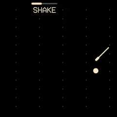
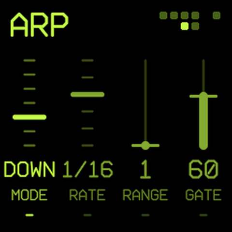

# h1

Custom firmware for the M-VAVE FM-1. You get nine instruments, and each one is a full-screen animated
picture you play. Everything is drawn in one ink colour on the bezel's black, so the screen reads
bigger than it is.

  
  
  

**The full guide is at [jakehandy.com/h1](https://jakehandy.com/h1).** It covers every instrument's
knobs and algorithms, the settings pages, loop and step recording, and FAQs.

| | Sound | Knobs |
|---|---|---|
| **PIP** | chiptune | SHAPE, WOBBLE, ZAP, CRUNCH |
| **BONK** | drum kit, a drum on every note of the octave | TUNE, DECAY, PUNCH, DIRT |
| **URCHIN** | FM | RATIO, DEPTH, FUZZ, TAIL |
| **TWANG** | plucked strings | DAMP, PICK, TONE, BUZZ |
| **LAVA** | wavefolder bass | FOLD, HEAT, LEAN, SUB |
| **KNOT** | additive bells | BLOOM, RING, TWIST, WARP |
| **INK** | gliding lead | SLIDE, SHAKE, PRESS, DRY |
| **TIDE** | analog pad | GLOW, HALO, DRIFT, SURGE |
| **HAUNT** | spooky ambient | FOG, DREAD, SHIVER, DEPTH |

  

## Install

h1 isn't released for the device yet. The design is being approved in the browser simulator first.
The device port in `port/fm1` is written, but it hasn't been compiled or flashed, and nothing should
be flashed until the simulator is signed off.

**Try it now in the browser:** open [the simulator](https://jakehandy.com/public/h1/simulator.html),
or build it yourself with `tools/build_web.sh` and open `dist/h1-simulator.html`. It runs the same C
code that goes on the device.

**On the FM-1 (once there is a build):** h1 is built on
[fm1-base](https://github.com/charlesvestal/fm1-base) and installs the same way as other FM-1
firmwares.

1. Update the FM-1 to stock firmware V15 with M-VAVE's updater.
2. Connect it over USB to a computer running Chrome or Edge.
3. Open the h1 installer page, allow MIDI access, and send the package. Keep the cable in until it
   says it's done.

To go back to stock, run M-VAVE's updater again. If a flash fails, hold OCT − while you power on to
reach rescue mode. The installer link will be added here with the first device build.

## Hotkeys

| Control | What it does |
|---|---|
| PRESETS | Instrument |
| ALGORITHM | One of the instrument's eight algorithms |
| KNOB 1–4 | Home screen: the instrument's four live modulations. Settings page: its four columns |
| SELECT | Home screen: tempo. Settings page: next page. Writing steps: moves the cursor |
| FX SEL ENV LFO GLO ARP SEQ | Open that settings page. Press it again, or HOME, to go back |
| REC / PLAY | Loop: REC arms a take, again closes it, again overdubs. PLAY stops and starts it. Step: REC turns step-write on and off, PLAY runs the pattern |
| EDIT | Pins the knob strip on the home screen. Writing steps: leaves a rest |
| OCT − / + | Octave, two each way. Press both for the middle octave |
| hold SEQ | Swap LOOP and STEP |
| hold REC | Clear the loop or the pattern |
| hold HOME | Silence everything |
| hold SAVE | Reset this instrument (everything else saves by itself) |

In the simulator: <kbd>A</kbd>–<kbd>'</kbd> are the white keys from F and <kbd>W</kbd> <kbd>E</kbd> <kbd>R</kbd> <kbd>Y</kbd> <kbd>U</kbd> <kbd>O</kbd> <kbd>P</kbd> <kbd>[</kbd>
the black keys. <kbd>Z</kbd> <kbd>X</kbd> change the octave, <kbd>←</kbd> <kbd>→</kbd> change the
instrument, and <kbd>↑</kbd> <kbd>↓</kbd> change the algorithm. <kbd>1</kbd>–<kbd>4</kbd> turn a knob
up, or down with <kbd>Shift</kbd>.

## For developers

See [docs/ARCHITECTURE.md](docs/ARCHITECTURE.md) for how the code is laid out and
[docs/RESEARCH.md](docs/RESEARCH.md) for the hardware and what was learned from other firmwares.
`python3 tools/guide_media.py` renders the pictures in `docs/img` from the current build. Add
`--site <path to jakehandynew>` to also copy them, and the simulator, to the guide site.
